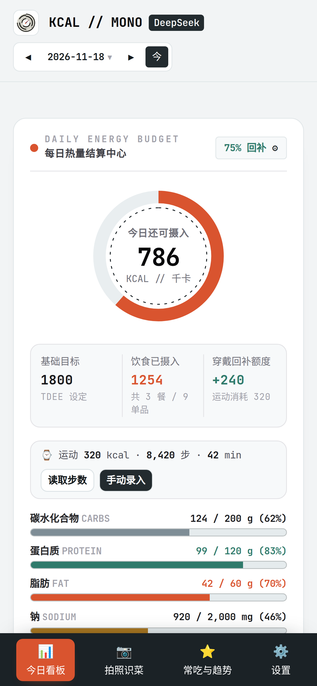
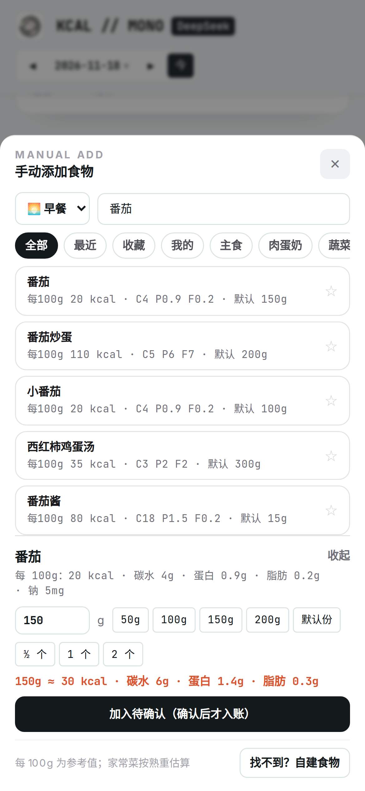
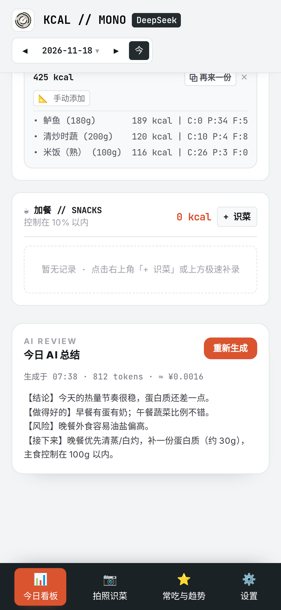
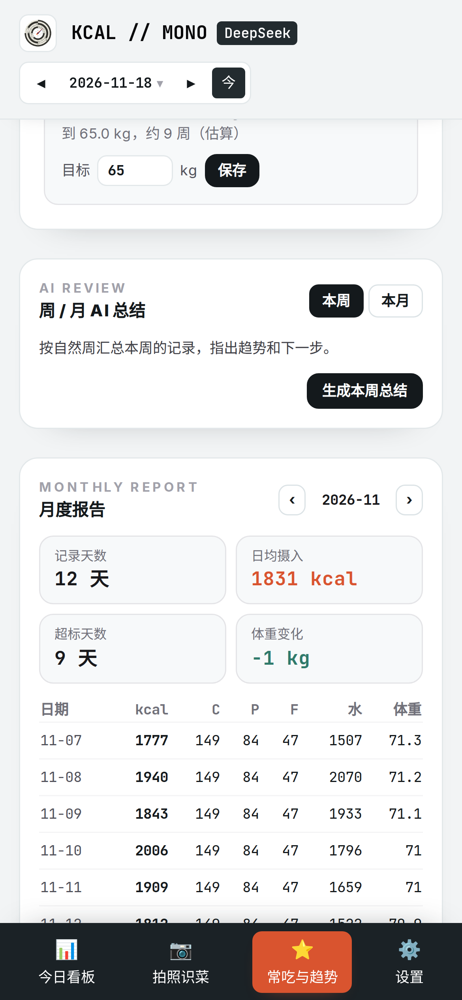

# 轻卡账本 · KCAL // MONO

> 一个为中式饮食设计的本地优先热量与营养账本。AI 拍照识菜、340 条中式食物库、周热量池、AI 复盘、月度报告，安装包约 **1.1MB**。

[](#)
[](LICENSE)
[](#)
[](#测试)

**English**: A local-first calorie & nutrition tracker built for Chinese food. AI photo recognition, 340-item Chinese food database, weekly calorie bank, AI reviews and monthly reports. Android 7.0+, ~1.1 MB, no account, no ads, no cloud sync.

---

## 为什么做这个

大部分热量 App 要么安装包很大、要么广告/会员/强制登录，食物库还全是西式食材。我想要一个：

- 打开就能记，数据只在自己手机里
- 能看懂食堂、家常菜、外卖和国产包装食品
- 不要求注册，不偷偷上传数据
- 安装包小，老手机也能跑

于是有了「轻卡账本」。它用 Android WebView 承载一个单页应用，原生壳只做相机、相册、计步、提醒、小组件这些系统能力，所以体积能做到 1.1MB。

## 功能

### 记录

- **AI 拍照识菜**：中餐菜肴 / 包装营养成分表 / 体脂秤报告三种模式，逐项改克重、调油水系数
- **一句话补录**：自然语言拆成食物条目，先出待确认卡，确认后才入账
- **手动添加**：340 条中式食物库，拼音搜索、收藏、常用份量、钠含量；支持自建食物
- **条码查询**：OpenFoodFacts；查不到时给离线速查 / 文字补录入口
- **常吃库**：新增、编辑、删除、多选批量入账

### 看板与分析

- 每日热量结算、三大营养素真实占比、钠摄入与超标建议
- 周热量池：自然周结算，工作日攒、周末花
- 饮水、体重、腰围、体脂、骨骼肌、内脏脂肪
- 目标体重与到达时间估算（线性外推，明确标注估算）
- **AI 日 / 周 / 月总结**：结合摄入、营养素、钠、饮水、运动和目标，输出结论 / 做得好的 / 风险 / 接下来；同周期缓存
- **token / 费用统计**：按调用时高峰/空闲价记账

### 导出与系统集成

- 月度报告：CSV（带 BOM，Excel 直接打开）+ 1080×1350 PNG
- 桌面小组件：1x1 / 2x2+ 自适应
- 通知栏常驻：今日剩余热量 + 「+250ml 水」「记一餐」快捷
- 自动备份：每天一份到 `下载/KCAL/自动备份`，保留 7 份，设置内可恢复

## 截图

> 截图使用演示数据，不含真实账本、体重或 API Key。

<table>
  <tr>
    <td align="center"><br><sub>今日看板</sub></td>
    <td align="center"><br><sub>手动添加食物</sub></td>
    <td align="center"><br><sub>AI 日总结</sub></td>
    <td align="center"><br><sub>月度报告</sub></td>
  </tr>
</table>

## 安装

1. 到 [Releases](../../releases/latest) 下载 `轻卡账本-vX.Y.Z.apk`
2. 允许「安装未知来源应用」
3. 安装后打开即可使用；不配置 API Key 也能用手动食物库、条码和离线词典

**环境**：Android 7.0+（minSdk 24），国行无 GMS 可用。

### 鸿蒙 7 / 浏览器

鸿蒙 NEXT 不再支持 APK，可直接用浏览器打开 <https://hcooo3.github.io/QKZB/>，再「添加到桌面」。详见 [PWA.md](PWA.md)。

### 配置 AI（可选）

设置 → 01 多模态接口配置 → 选 DeepSeek / Gemini / 通义千问等 → 填 Base URL、模型名、API Key → 保存。

Key 会用 Android Keystore 加密保存在本机，不写入备份、迁移码或自动备份。

## 隐私

- 账本、体重、饮水等数据保存在本机 WebView 的 localStorage
- 没有账号系统，没有自建服务器，没有埋点上报
- API Key 用 Android Keystore AES-256-GCM 加密
- 导出备份、迁移码、自动备份都会剔除 API Key
- 只有调用 AI 时会把当次提示词和图片发给你配置的服务商

**注意**：数据只在本机，卸载前请先在「设置 → 04」导出备份。

## 技术栈

- Android 原生壳：Java + WebView，无 Gradle，本地用 `aapt + javac + dx + apksigner` 出包
- 前端：单页 HTML + CSS + 原生 JS，Tailwind / Chart.js 本地化，无构建步骤
- 数据：340 条食物库（JSON，含拼音与钠），localStorage 单键存储
- 测试：jsdom + Node，103 项断言
- 包体：约 1.1MB

```
web/
  index.html      页面结构
  app.css         样式
  app.js          页面逻辑
  foods.js        340 条食物库
apk/
  src/main/java/  原生壳（相机、相册、计步、提醒、小组件、Keystore）
  src/main/res/   图标、布局、主题
build.sh          本地一键出包
test-core.js      103 项 jsdom 测试
```

## 本地构建

```bash
# 依赖：openjdk-17-jdk-headless aapt zipalign apksigner dalvik-exchange unzip zip
# 资源链接用 API 23 的 android.jar；javac 用 API 35 的 android.jar
# 签名口令从环境变量读取（不要写进仓库）
export KCAL_KS_PASS='你的签名口令'
./build.sh
# 产物 build/kcal-signed.apk
```

构建细节见 [BUILD.md](BUILD.md)。

## 测试

```bash
node test-core.js
```

覆盖：空账启动、schema 迁移、周热量池、饮水、常吃编辑/批量、条码失败兜底、AI 总结/用量、自动备份恢复、日期抽屉、手动食物库（拼音/收藏/钠/份量）、月报 CSV/PNG 等。

## 已知限制

- AI 识别和营养估算有误差，结果仅供参考，不构成医疗建议
- OpenFoodFacts 国产包装覆盖有限
- 钠与部分食物营养值为参考/估算值
- 仅 Android，无 iOS、无云同步
- 部分国产 ROM 的省电策略会延迟每日提醒
- 小组件/通知的可用性依赖系统权限

## Roadmap

- [ ] 更多外卖/快餐与地方菜
- [ ] 常用份量自定义（个/盒/碗）
- [ ] 月度报告更多图表
- [ ] 主题 token 继续收敛
- [ ] 更多测试与 CI

## 反馈

提 Issue 时请附：机型 + ROM/Android 版本 + 复现步骤 + 截图（AI 问题附原图）。模板见 `.github/ISSUE_TEMPLATE/`。

- [贡献指南](CONTRIBUTING.md)
- [安全说明](SECURITY.md)
- [更新记录](CHANGELOG.md)

## 协议

MIT，见 [LICENSE](LICENSE)。食物营养数据为参考/估算值，来源包括中国食物成分表与 USDA FDC；条码数据来自 OpenFoodFacts（ODbL）。

## 致谢

Tailwind CSS、Chart.js、Inter / JetBrains Mono、OpenFoodFacts、DeepSeek。
